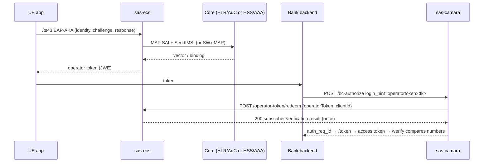

# SAS layered architecture — CAMARA gateway → subscriber exposure → operator adapter

**Status: Accepted 2026-10-01** (owner review of the architecture and decisions D1–D8, R1–R5).
**Contract approved 2026-10-01** (second review, R6–R10).

The interface contract
[`openapi/sas-subscriber-exposure-v1.yaml`](openapi/sas-subscriber-exposure-v1.yaml) is
**v1.0.0, approved**. Its schema is unchanged from draft 1; the review added explanatory notes
only. Migration may proceed from M1.

When migration step M6 (§8) lands, this record replaces
[`sas-two-binary-architecture.md`](sas-two-binary-architecture.md). Until then that document
still describes the code as it is.

The 2026-10-01 split separated the system by **track** (cellular in `sas-camara`, Wi-Fi/TS.43
in `sas-ecs`), so `sas-camara` still signals the core itself (resolver, S6a, SWx/MAP
verifiers). The owner's intent is a split by **layer**:

```
API consumer → CAMARA API gateway → (3GPP-inspired exposure REST) → entitlement server → (MAP, Diameter) → core NW
UE ──TS.43──► entitlement server ──► HSS/UDM/AuC
```

---

## 0. Decision log

### 0.1 Architecture decisions

| # | Decision |
|---|---|
| D1 | **Interface between the binaries.** A REST API **inspired by** 3GPP network exposure (TS 29.522 UEId, TS 29.122 MonitoringEvent semantics). It does **not** claim conformance: those are AF↔NEF/SCEF APIs, and `sas-ecs` is not an NEF. DTOs follow the 3GPP field model so a real NEF can be mapped later. Every difference is listed under `x-deviation` in the contract. SIM change and token redemption are vendor extensions. |
| D2 | **Two binaries.** `sas-camara` is internet-facing, stateless and scales with API traffic. `sas-ecs` sits in the operator trust zone and is stateful (EAP-AKA, SIM lifecycle, SS7/Diameter). No third binary. No all-in-one now, but the `SubscriberService` abstraction keeps a later `sas-platform-all` demo assembly possible. |
| D3 | **Operator tokens are redeemed at the entitlement server.** `sas-camara` holds no identity state: no token keys, no issuer JWKS, no ledger. |
| D4 | **OTP SMS delivery** (SGd/SMSC) moves to the entitlement side **in a later phase**. |
| D5 | **`/session-tuple` moves to `sas-ecs`** (device surface). The resolver and all subscriber evidence belong to the ECS boundary; `sas-camara` keeps only CAMARA transaction state. |
| D6 | **`Authorization: Bearer operatortoken:` directly on `/verify`** stays for lab/test compatibility. It is marked as an SAS extension and is off in the prod profile (preflight). The CAMARA paths are CIBA `login_hint` and JWT-bearer `sub`. |
| D7 | **The operator-token ledger leaves `sas-camara`.** Flyway drops the gateway table. The ECS owns the ledger as issuer and redeemer. |
| D8 | **The ECS operator-token `/jwks.json` is removed.** Issuer keys are not exposed under the old model. If key distribution is ever needed, it gets its own trust model (mTLS trust or an internal JWKS), outside the current CAMARA flow. |

### 0.2 Review outcomes

| # | Outcome |
|---|---|
| R1 | **`SubscriberService` boundary.** `sas-camara` calls only the `SubscriberService` interface. The entitlement side decides the source (SIM DB, HLR, HSS/Sh, ECS, later UDM). This is the boundary that lets a real NEF or operator platform replace `sas-ecs` without touching `sas-camara`. |
| R2 | **Rename `sas-transport` → `sas-operator-adapter`** (artifact + directory). Java packages `et.restlink.sas.ras.*` stay, so the H24 `/ras/` rule is unchanged. |
| R3 | **Naming of the exposure layer.** It is the **subscriber exposure service** (module `sas-subscriber-exposure`, path `/sas-subscriber-exposure/**`), never "NEF". It runs inside `sas-ecs`. |
| R4 | **Data source stays internal.** `evidenceSource` lives on internal responses and in the CAMARA CDR only. There is no `X-Operator-Data-Source` header, and no CAMARA public response reveals an internal data source. |
| R5 | **Terminology.** "Operator Token" keeps the CAMARA ICM terminology: `login_hint=operatortoken:` / JWT-bearer `sub=operatortoken:`, "a TS.43 token" (`docs/research/camara/camara-api-access-and-user-consent.md`). What a redemption returns is the **subscriber verification result**. No `subscriber_hash` claim is added. `authMethod` names only the mechanism actually implemented (`EAP-AKA`; `EAP-AKA'` is not offered until it exists). |

### 0.3 Contract review (2026-10-01)

| # | Outcome |
|---|---|
| R6 | **GPSI from UE ID retrieval.** Approved as a stated deviation: a production NEF may expose an AF-scoped external identifier; **this SAS profile exposes the GPSI for a closed operator sandbox / testing**. It is not standard `Nnef_UEId` behaviour. IMSI/SUPI is never exposed outside the operator domain, and the SUPI ↔ GPSI mapping exists only inside it (`sas-ecs` and the core). |
| R7 | **Exposure token endpoint on `sas-ecs`.** Approved, for the `sas-camara → sas-ecs` hop only. External clients (bank, app, sandbox) still authenticate only at CAMARA OAuth on `sas-camara`. `sas-ecs` is not a public OAuth authority. Integrating an operator IAM later (`sas-camara → operator IAM → sas-ecs`) replaces only the token issuer and does not change `SubscriberService`. No IAM/operator federation in this phase. |
| R8 | **Location evidence metadata.** `ageOfLocationInfo` + `plmnId` are evidence metadata (freshness, home/visited network), not a location: no latitude/longitude, ECGI/NCGI, TAC or cell identity crosses the boundary. The MAP/Diameter verifier in `sas-ecs` produces the evidence; the CAMARA policy engine decides freshness and relevance. |
| R9 | **One phone-number normalizer.** A single `PhoneNumberNormalizer` in `sas-common` is the only place numbers are converted: input E.164 `+<digits>` → internal TS 23.003 digits → GPSI `msisdn-<digits>` or CAMARA canonical `+<digits>`. It replaces six divergent helpers found today: `RequestValidator.normalizeE164` (used by `TokenResource`), `EntitlementSbb.normaliseMsisdn` (adds `+` but keeps spaces), `PcrfSdResolverBackend.normalizeE164` (strips every non-digit), `SubscriberDbBinding.normalise` (cuts `@realm`, drops `+`), `MapSendImsiBinding.normaliseMsisdn` (drops `+` only), and the HLR simulator's own copy. |
| R10 | **Redemption identity is the token `jti`.** Redeem idempotency is keyed on `(jti, X-Request-Id)`, never on `X-Request-Id` alone. A request id reused across different tokens by a client bug gets no replayed answer, and the token is still redeemed at most once. |

## 1. Architecture decision record

**Context.**
- Scale profiles differ. CAMARA traffic is millions of stateless API calls. Subscriber
  authentication is stateful (outstanding EAP-AKA challenges, the single-use ledger) and
  sits next to SS7/Diameter links and SIM credentials, which belong in the operator trust
  zone.
- CAMARA ICM leaves "how the API Provider validates the temporary token with the
  Entitlement Server" out of scope. That validation has to be an explicit interface.

**Decision.**
- `sas-camara` is the CAMARA API gateway: OAuth/IAM, CAMARA APIs, consent, policy
  (assurance scoring).
- `sas-ecs` is the entitlement server: TS.43 ECS, Token Service, subscriber exposure
  service, Subscriber Services and the operator adapter.
- The only path between them is the subscriber exposure API (§4), over mTLS with OAuth2
  client credentials.

**Consequences.**
- Every MAP and Diameter packet leaves from `sas-ecs` and nothing else.
- `sas-camara` autoscales, apart from the OAuth code/CIBA store (§7.4).
- One extra HTTP hop per stage; the budgets are in §7.
- If the operator already runs an NEF/SCEF, a different `SubscriberService` client can
  target it. That client is a mapping layer, not a rewrite, because the DTOs follow 3GPP
  fields. Known gap (R6): a production NEF may return an AF-scoped `externalId` from UE ID
  retrieval rather than a GPSI. Exposing the GPSI is this profile's choice for a closed
  operator sandbox/testing (contract `x-deviation`).

**Alternatives rejected.**

| Alternative | Why not |
|---|---|
| One binary | No enforceable boundary between the internet-facing tier and the SS7/Diameter tier. Kept only as a future demo assembly. |
| CAMARA calls TS.43 endpoints directly | Couples the gateway to device-facing EAP semantics; the gateway must not know TS.43. |
| Custom REST with no 3GPP model | Nothing to align with when a real NEF appears. |
| CAMARA keeps verifying tokens via JWKS (current code) | Contradicts D3: the gateway would keep keys and a ledger. |

## 2. Component boundary

```
            Z1  internet / partner zone                     Z2  operator trust zone
 ┌──────────────────────────────────────────┐        ┌──────────────────────────────────────────────┐
 │ sas-camara  (binary 1, stateless)        │ HTTPS  │ sas-ecs  (binary 2, stateful)                │
 │  OAuth/IAM: /authorize /bc-authorize     │ mTLS + │  Subscriber exposure service (§4)            │
 │    /token, discovery, JWKS (own keys)    │ OAuth2 │   /sas-subscriber-exposure/v1/**             │
 │  CAMARA: NV v2, SIM Swap v2, OTP SMS*    │  CC    │  Subscriber Services (SBB: source choice)    │
 │  consent · policy (assurance scoring)    │───────►│  Token Service (issue · ledger · redeem)     │
 │  SubscriberService ─► RA ras/exposure    │        │  TS.43 ECS: /ts43 · /session-tuple (devices) │
 │  CDR (billing per API call)              │        │  Operator adapter (RAs): MAP · S6a · SWx ·   │
 │  NO MAP/Diameter/SCTP · NO TS.43         │        │   Sh · Gx/RADIUS/CGNAT resolver              │
 └──────────────────────────────────────────┘        └──────────────┬───────────────────────────────┘
        ▲ bank backend, GSMA sandbox             UE ──TS.43 (HTTPS)──►│ MAP over SCTP/M3UA · Diameter over SCTP
                                                                     ▼
                                                      HLR/AuC · HSS · PCRF · 3GPP AAA · (UDM later)
 * OTP SMS stays on sas-camara with the lab sender until D4 moves delivery.
```

`sas-ecs` serves **two interfaces with separate authentication policies**:

| Interface | Paths | Caller | Authentication policy |
|---|---|---|---|
| Subscriber exposure | `/sas-subscriber-exposure/v1/**`, `/sas-subscriber-exposure/oauth2/token` | `sas-camara` only | mTLS with the sas-camara client certificate pinned, **and** a certificate-bound client-credentials access token with the operation's scope (§5.2) |
| Device | `/ts43/**`, `/session-tuple` | devices | TLS; EAP-AKA on `/ts43`; per-IMSI / per-source rate limits (P1 item) |

A device can never reach the exposure interface. A request on an exposure path without the
pinned client certificate is refused at the TLS/HTTP policy layer, before any resource code
runs. Prod preflight refuses a boot where the two policies are not both configured.

## 3. Modules and dependency rules

| Module | Role | Change |
|---|---|---|
| `sas-common` | model, `SasTimeouts`, API-key auth | none |
| `sas-token` | JOSE (ES256 JWS, JWE) | none |
| **`sas-subscriber-api`** (new) | the contract in Java: `SubscriberService` interface, DTOs and problem causes of the OpenAPI. Pure Java, no I/O. | new |
| `sas-api` | CAMARA gateway logic: oauth, camara-api, consent, policy | loses `OperatorTokenAnchor` key/JWKS/ledger logic and `SessionTupleResource` (D5); anchors call `SubscriberService` |
| `sas-entitlement` | ts43, sim-auth (EAP-AKA), Token Service | gains the ledger + redeem; the token audience becomes the ECS itself |
| **`sas-subscriber-exposure`** (new) | exposure REST resources, exposure token endpoint, `/session-tuple` (D5), Subscriber Services logic (source order, evidence assembly) | new; logic moves from `VerifySbb` (signalling part) and `HostSimSwapEvidence` |
| `sas-transport` → **`sas-operator-adapter`** | RAs: MAP (jSS7), Diameter S6a/SWx/Sh (corsac), Gx/RADIUS/CGNAT resolver, auth-vector, binding | renamed; gains `resolver` + `s6averifier` from `sas-host/ras` |
| `sas-host` = **sas-camara** | `SasBootstrap`, `VerifySbb` (orchestration + scoring only), RA `ras/exposure` (the only outbound HTTP client), CDR, admin | drops `ras/resolver`, `ras/s6averifier`, `ras/optoken` and the adapter dependency |
| `sas-ecs-host` = **sas-ecs** | `EcsBootstrap`, `EntitlementSbb`, **`SubscriberSbb`**, adapter RAs, DB (ledger) | gains exposure + subscriber services |

**Rules (gate H25, rewritten in M5):**

1. `sas-host` and `sas-api` may depend only on `sas-common`, `sas-token` and
   `sas-subscriber-api`.
   - Forbidden dependencies: `sas-operator-adapter`, `sas-entitlement`,
     `sas-subscriber-exposure`, jSS7, corsac/diameter, `sctp`.
   - Forbidden in source: imports of `org.restcomm.protocols.ss7`, the corsac/diameter
     packages, and `et.restlink.sas.entitlement`.
2. The **packaged** `sas-camara` dist (`lib/`) contains no `*sctp*`, `*ss7*`, `*map-*`,
   `*diameter*` jar. This is checked on the artifact, not only on the pom.
3. `sas-ecs-host` and its libraries do not depend on `sas-api`.
4. H24 is unchanged in spirit:
   - One micro-jainslee seam per binary (`SasBootstrap`, `EcsBootstrap`).
   - I/O only in `/ras/`; the exposure HTTP client is an RA.
   - Subscriber Services are SBBs; REST resources only submit events.

## 4. Subscriber exposure API

**Contract (source of truth):**
[`openapi/sas-subscriber-exposure-v1.yaml`](openapi/sas-subscriber-exposure-v1.yaml).
- OpenAPI 3.1.
- Validated with `openapi-spec-validator`; every example validates against its schema.
- Field names were checked against the 3GPP OpenAPI files of TS 29.522 V18.4.0
  (`3gpp-ueid`) and TS 29.122 V18.5.0 (`3gpp-monitoring-event`).

Base: `{apiRoot}/sas-subscriber-exposure/v1`.

| Operation | Path | Modelled on | Main deviations (full list in the contract) |
|---|---|---|---|
| `RetrieveUeId` | `POST /ue-id/retrieve` | TS 29.522 `3gpp-ueid` `POST /retrieve` (`UeIdReq`/`UeIdInfo`) | Returns `gpsi` instead of the AF-specific `externalId`; `portNumber` and `observedAt` (extension) mandatory (CGNAT, point-in-time); `ueMacAddr` unsupported. Errors: `404 NO_BINDING`, `409 AMBIGUOUS_BINDING`. |
| `CreateMonitoringEventSubscription` | `POST /monitoring-event/{scsAsId}/subscriptions` | TS 29.122 `3gpp-monitoring-event`, immediate-report form (`200` + `MonitoringEventReports`) | No `notificationDestination`, no subscription resource; `maximumNumberOfReports=1`, `immediateRep=true`. Only `UE_REACHABILITY` + `LOCATION_REPORTING`; `LAST_KNOWN_LOCATION` only. `LOCATION_REPORTING` returns **location evidence metadata** only: `ageOfLocationInfo` + `plmnId`, with no coordinates, ECGI/NCGI, TAC or cell id (R8). `ueReachable` is an extension. |
| `RetrieveSimChange` | `POST /sim-change/retrieve` | vendor extension, T8 style | Whole operation. `404 NO_EVIDENCE` is fail-closed; never "not swapped". |
| `RedeemOperatorToken` | `POST /operator-token/redeem` | vendor extension, RFC 7662-like, single use | Whole operation. Returns the **subscriber verification result** `{msisdn, authMethod, authenticatedAt, simVerified, tokenId}`; every refusal is the same `401 INVALID_TOKEN`. |

**Identifiers** follow the 3GPP API each operation borrows from:
- `msisdn` is TS 23.003 digits without "+" (T8 style, also used by the two extensions).
- `gpsi` is `msisdn-<digits>` (TS 29.571), used only in the UE ID answer.
- The gateway converts to and from E.164 `+…` for CAMARA.
- Every conversion, on both binaries, goes through `PhoneNumberNormalizer` in
  `sas-common` (R9). No service normalizes on its own.

**Common headers:**

| Header | Purpose |
|---|---|
| `X-Request-Id` | The CAMARA `reqId`. Dedup key with the operation for 60 s. For redeem the key is `(token jti, X-Request-Id)` (R10): a retried redeem returns the recorded 200 instead of a 401, and a request id reused for a different token gets no replay. |
| `X-Sas-Budget-Ms` | Remaining caller budget. ECS clamps stage budgets to it; `504 BUDGET_EXHAUSTED` when it cannot cover one stage. |

**Errors:** TS 29.122-shaped `ProblemDetails` with a `cause` code. IMSI, token content and
token-refusal reasons never appear in a response.

## 5. Security model

### 5.1 Trust zones

Z1 → Z2 has exactly one allowed flow: `sas-camara` → `sas-ecs` exposure interface. Devices
reach only the device interface of Z2 (§2).

### 5.2 Gateway ↔ ECS

- **Transport:** mTLS; `sas-ecs` pins the `sas-camara` client certificate.
- **Authorization:**
  - An access token from the ECS exposure token endpoint
    (`/sas-subscriber-exposure/oauth2/token`).
  - Grant `client_credentials` with client authentication `tls_client_auth` (RFC 8705 §2.1).
  - ES256 `at+jwt`, `aud` = the exposure API, **certificate-bound** (`cnf.x5t#S256`, RFC 8705
    §3), lifetime ≤ 300 s.
  - One scope per operation: `exposure:ue-id`, `exposure:monitoring`, `exposure:sim-change`,
    `exposure:operator-token`.
  - Follows the CAPIF pattern (TS 33.122) without implementing CAPIF.
- **AF identity:** the `afId` / `scsAsId` in a request must equal the token's client
  (`403 AF_MISMATCH`).
- **Boundary of the token endpoint (R7).**
  - It serves the `sas-camara → sas-ecs` hop only. It is not a public OAuth authority.
  - External clients (bank, app, sandbox) authenticate only at CAMARA OAuth on
    `sas-camara`.
  - A later operator IAM would replace the token issuer, `sas-camara → operator IAM →
    sas-ecs`, without changing `SubscriberService` or the contract.
- **Prod preflight (new PRO checks, M4)** refuses a boot with any of: a plain-HTTP exposure
  URL; a missing client certificate or key; an ECS exposure interface without client-cert
  pinning or without token enforcement; a lab-shaped exposure client.

### 5.3 Operator token (D3, D7, D8, R5)

- **Issuance.** The ECS issues the token after EAP-AKA succeeds on `/ts43`, in the current
  format: an ES256 JWS (`typ=operator-token+jwt`) nested in an ECDH-ES/A256GCM JWE. The JWE
  keeps the MSISDN unreadable on the device.
- **Claims are only what redemption needs:** `iss`, `aud`, `iat`, `exp` (lifetime
  ≤ 300 s), `jti`, `phone_number`, `eap_method`. `aud` becomes the ECS itself, and the JWE
  is encrypted to the ECS's own key.
- **Redemption.**
  - Only the ECS redeems tokens: it decrypts, verifies, and inserts the `jti` into its
    ledger (PostgreSQL in prod).
  - The ledger stores the `jti` only. This is why the JWE format is kept rather than an
    opaque handle: a handle would force the ECS to store MSISDN-per-token at rest.
  - `sas-camara` forwards the token unchanged and holds no key for it.
- **Retired** (in M3):
  - The gateway table `sas_operator_token_jti` (Flyway V4 drop, D7).
  - `HttpJwksKeySource`.
  - The ECS operator-token `/jwks.json` (D8).
- **Wire prefix.** `operatortoken:` stays exactly as CAMARA ICM defines it.
- **Direct-bearer form (D6).** `Bearer operatortoken:` on `/verify` remains a lab-only
  extension; prod preflight refuses it.

### 5.4 Data minimisation and audit

- `evidenceSource` is internal. It is valuable for production audits too (which source
  decided a SIM-change date matters in a dispute), so it is not "debug only". It is
  recorded in the CAMARA CDR next to the `reqId`. A test asserts that no CAMARA response
  body or header carries it.
- IMSI/SUPI never crosses Z2 → Z1, and the SUPI ↔ GPSI mapping exists only in Z2 (R6).
  MSISDN crosses Z2 → Z1 only to the gateway, never to the app.
- Only location evidence metadata crosses (age + PLMN). No coordinates, ECGI/NCGI, TAC or
  cell identity crosses (R8).

## 6. Sequence diagrams

Paths are relative to `/sas-subscriber-exposure/v1`.

### 6.1 NV, cellular (Authorization Code + PKCE; `/verify` with the access token)

```mermaid
sequenceDiagram
  participant D as Device (cellular)
  participant G as sas-camara
  participant E as sas-ecs
  participant C as Core (PCRF/HLR/HSS)
  D->>G: GET /authorize (src IP:port, ts)
  G->>E: POST /ue-id/retrieve {ueIpAddr, portNumber, observedAt}  [wait 400 ms]
  E->>C: Gx/RADIUS/CGNAT lookup (300 ms)
  C-->>E: binding
  E-->>G: 200 {gpsi}
  G-->>D: 302 code
  Note over G: bank: /token (code + verifier) → ES256 access token
  G->>E: POST /monitoring-event/{afId}/subscriptions  ∥  POST /sim-change/retrieve  [wait 2.2 s]
  E->>C: MAP PSI or S6a ULR + Sh UDR  ∥  MAP SAI / SIM DB / Sh UDR
  C-->>E: answers
  E-->>G: MonitoringEventReports + SimChangeInfo
  Note over G: score → true / false / FALLBACK; CDR keeps evidenceSource
```

### 6.2 NV, Wi-Fi (TS.43 → CIBA `login_hint=operatortoken:`)



### 6.3 SIM Swap (CIBA or client credentials)

The gateway calls `POST /sim-change/retrieve`. `SubscriberSbb` walks the source order. With
no evidence the answer is `404 NO_EVIDENCE`, and CAMARA keeps today's fail-closed answer:
never `swapped:false` without evidence.

### 6.4 TS.43 UE authentication and `/session-tuple`

Device ↔ `sas-ecs` only, never through `sas-camara`.

## 7. State, FSM and timeouts

### 7.1 Gateway FSM

The gateway FSM is unchanged: `RESOLVING → VERIFYING → SCORING → APPROVED`, and any missing
evidence or timeout leads to `FALLBACK`. RESOLVING is one exposure call (UE ID); VERIFYING is
two parallel exposure calls (monitoring, SIM change).

### 7.2 Budgets

| Leg | Inside ECS | Gateway waits | On expiry |
|---|---|---|---|
| UE ID | resolver 300 ms | 400 ms | FALLBACK |
| monitoring ∥ SIM change | MAP/Diameter 2 s each, dialog aborted at expiry | 2.2 s | FALLBACK; factor = 0 |
| redeem | DB insert ≤ 200 ms | 300 ms | 401 at CAMARA (fail-closed) |
| total `/verify` | — | 3 s | bank normal login |

`X-Sas-Budget-Ms` makes the ECS stop signalling once the gateway has given up.

### 7.3 Failure mapping

| ECS answer (`cause`) | CAMARA outcome |
|---|---|
| 200 | use the evidence |
| 404 `NO_BINDING`, 409 `AMBIGUOUS_BINDING` | NV `FALLBACK`; `/authorize` network authentication fails |
| 404 `SUBSCRIBER_NOT_FOUND` | NV `FALLBACK` |
| 404 `NO_EVIDENCE` (SIM change) | SIM Swap: today's no-evidence answer; NV factor `notSimSwapped = 0` |
| 401 `INVALID_TOKEN` | 401 / `invalid_grant` |
| 401/403 on the client credentials, 429, 5xx, 502 `NETWORK_ERROR`, 503 `TRANSPORT_UNAVAILABLE`, 504 `NETWORK_TIMEOUT`/`BUDGET_EXHAUSTED`, TLS or connect failure | `FALLBACK` (`VERIFY_TIMEOUT`/`VERIFY_ERROR`), **never `true`**, never `swapped:false` |

### 7.4 State left in each binary

| Binary | State | Notes |
|---|---|---|
| sas-camara | CAMARA transaction state only: OAuth authorization codes, CIBA bindings, CDR | Sticky load balancing until a shared store exists (pre-existing follow-up) |
| sas-ecs | outstanding EAP-AKA challenges, the token ledger, the exposure dedup window, the jSS7 stack | Sticky by IMSI, or a shared store before scale-out |

## 8. Migration plan

Each step leaves a green build (`mvn test`, hardness, preflight self-test) and runnable dists.

| Step | Work | Acceptance |
|---|---|---|
| **M0** | Commit the MAP fix separately (done: `1974e80`). This record accepted. OpenAPI written and validated (draft 1 `99d1ef3`; approved as v1.0.0). | done |
| **M1** | Rename `sas-transport` → `sas-operator-adapter`: directory, artifactId, poms, gate module lists, scripts, living docs. Mechanical; no behaviour change. Add `scripts/check-dependency-boundary.sh` (§9 test C) in its M1 form. | same test count; hardness all pass; boundary check: `sas-ecs` dist **contains** `sas-operator-adapter` |
| **M2** | ECS side, while the old gateway path still works. First, `PhoneNumberNormalizer` in `sas-common` (R9) with its test matrix, replacing the six helpers. Then: `sas-subscriber-api` + `sas-subscriber-exposure`, `SubscriberSbb`, the four operations + token endpoint. Move `resolver` + `s6averifier` + SIM-change evidence into the adapter/ECS, and `/session-tuple` to the ECS (D5). Token Service gains ledger + redeem (`(jti, X-Request-Id)` idempotency, R10) and `aud` = ECS. | unit tests; contract tests (§9 test A); curl against ECS → HLR sim / Diameter testapp |
| **M3** | Gateway side: RA `ras/exposure` (async HTTP client; `X-Request-Id` + `X-Sas-Budget-Ms`). `VerifySbb`, SIM Swap, `/authorize` network authentication and the CIBA/JWT-bearer anchors use `SubscriberService`. Delete `OperatorTokenAnchor` crypto, `HttpJwksKeySource`, `ras/resolver`, `ras/s6averifier`, `ras/optoken`, the ECS operator-token JWKS (D8). Flyway V4 drops the gateway ledger (D7). Remove the adapter dependency from `sas-host`. | `sas-camara` dist `lib/` has no sctp/ss7/diameter jar; all tests green |
| **M4** | Security: mTLS + certificate-bound client credentials, the two separate authentication policies of §2, the new PRO checks of §5.2, D6 enforcement in prod. | preflight self-test with new mutations |
| **M5** | Gates: H25 rewritten (§3 rules incl. the artifact check); H24 module list; H27 (the gateway trusts no operator token locally); new **H28** exposure-contract parity (OpenAPI operations ↔ ECS resources ↔ gateway client ↔ scopes); H22 path follows `/session-tuple` (D5). Mutation tests for H25/H28. | hardness + mutations |
| **M6** | E2E on packaged dists: HLR sim + Diameter testapp + `sas-ecs` + `sas-camara`. GSMA-sandbox-style flows (NV Auth Code, NV via CIBA operator token, SIM Swap). Test flow + demo script (vi and en, separate files), AGENTS.md, module READMEs (dual licence); `sas-two-binary-architecture.md` marked superseded. | §9 all met |

## 9. Acceptance criteria (gates, not checklist items)

1. **The gateway has no SCTP.** At runtime, the `sas-camara` PID owns no SCTP endpoint or
   association (`/proc/net/sctp/eps`, `/proc/net/sctp/assocs`). This runtime inspection is
   part of the E2E gate.
2. **The gateway artifact has no MAP/Diameter/SCTP.** The `sas-camara` dist contains no
   MAP, Diameter or SCTP dependency (`lib/` listing, H25).
3. **Pcap boundaries.**
   - Gateway traffic is HTTP/TLS only: clients ↔ gateway and gateway ↔ ECS exposure.
   - MAP/SCTP and Diameter/SCTP all originate from the `sas-ecs` PID. SCTP only, never TCP.
4. **TS.43 stays on the ECS.** No TS.43/EAP path or class exists in `sas-camara` (source +
   artifact).
5. **Interface separation.** A device request on an exposure path is refused (no client
   certificate), and an exposure call without the right scope gets 403.
6. **Single-use redemption.** The operator token is redeemed once, at the ECS. The gateway
   holds no token key, and a retried redeem with the same `X-Request-Id` is not a burn.
7. **Fail-closed everywhere.** Every row of §7.3 is covered by a test, and none yields
   `true` or `swapped:false`.
8. **`evidenceSource` stays internal.** It is in the CAMARA CDR and in no CAMARA response.
9. **Prove the artifact.** Dists are rebuilt and restarted, and each claim is shown on the
   running processes (jar listing, PID, pcap), not only by unit tests.

### 9.1 Named tests added by the contract review

| Test | What it proves | Introduced | Hard gate from |
|---|---|---|---|
| **A — contract compatibility** | Every request/response of the ECS resources and the gateway client validates against `sas-subscriber-exposure-v1.yaml`. Negative cases are refused with the documented `cause`: missing `gpsi` in a UE ID answer (gateway treats as `FALLBACK`), invalid MSISDN format (`400 INVALID_ARGUMENT`), expired / replayed / wrong-audience operator token (`401 INVALID_TOKEN`), wrong or missing client certificate (refused before the resource), missing scope (`403 SCOPE_MISSING`), `afId` ≠ token client (`403 AF_MISMATCH`). | M2 | M5 (H28) |
| **B — security boundary** | `sas-camara` → `/sas-subscriber-exposure/**` OK. Device → `/ts43/**` OK. Device → `/sas-subscriber-exposure/**` **refused**. | M4 | M4 |
| **C — dependency boundary** | `sas-ecs` dist contains `sas-operator-adapter`. `sas-camara` dist and dependency tree contain **no** MAP, Diameter, SCTP or SS7 artifact (jSS7, corsac/diameter, `sctp`, `sas-operator-adapter`). | M1 | ECS half from M1; gateway half from **M3** |
| **D — phone-number normalizer** | One matrix through `PhoneNumberNormalizer`: `+84xxxxxxxxx` → internal `84xxxxxxxxx` → GPSI `msisdn-84xxxxxxxxx` and CAMARA canonical `+84xxxxxxxxx`; same for `+251…`. Separators, a missing `+`, national/short forms and `@realm` suffixes each get one documented outcome. A source scan fails if any other normalizer remains. | M2 | M2 |

The gateway half of test C cannot pass before M3. Until then `sas-camara` still carries
the resolver and S6a RAs, which move in M2–M3. In M1 the script reports that half as known
debt and does not fail. It becomes a hard failure in the commit that removes the
dependency, so the boundary cannot quietly regress afterwards.

## 10. Still open (unchanged by this design)

- The EAP-AKA wire codec is not RFC 4187. `simVerified` means nothing for a real handset
  until it is fixed.
- `/ts43` abuse controls.
- D2/D5 operator agreements in `entitlement-core-nw-plan-2.md` (a different D-series).
- Refresh tokens.
- A shared store for OAuth codes and CIBA bindings.
- OTP SMS delivery to the ECS (D4, later phase).
- Operator IAM / federation for the exposure hop (R7, later phase).
