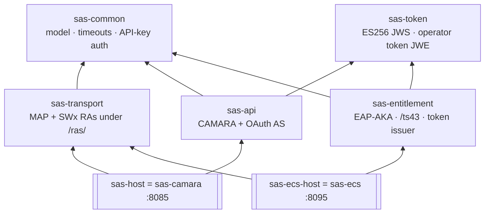
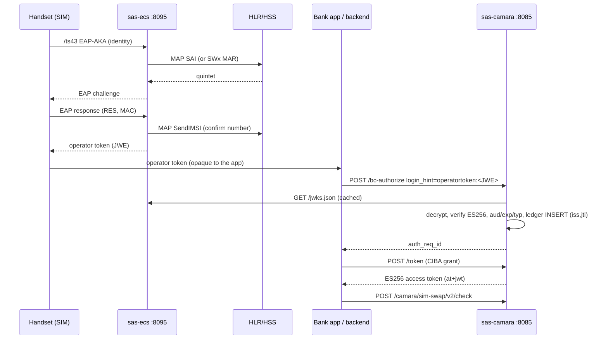
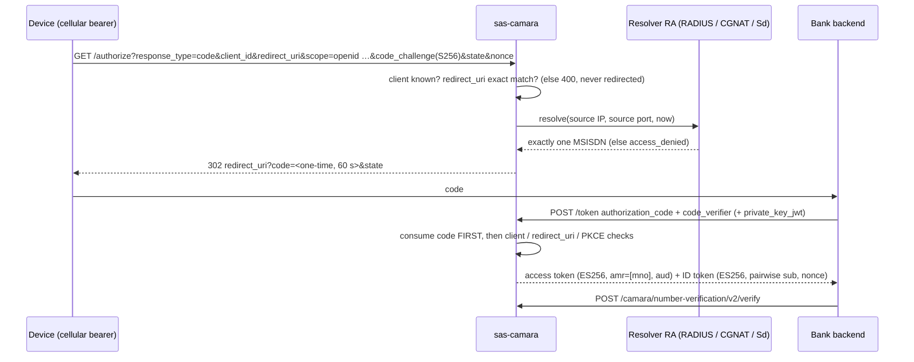

# SAS as two binaries — CAMARA server (`sas-camara`) + TS.43 entitlement server (`sas-ecs`)

Status: **implemented and lab-verified 2026-10-01** (build, 647 unit tests, 37/37 hardness
gates, 19/19 gate mutations, 41/41 preflight scenarios, two-binary smoke with pcap).
Production P1 is **not** reached yet — see §9 for the blockers that remain.

Owner decisions recorded for this work (2026-10-01):

| # | Decision |
|---|---|
| 1 | History of `098458b` is **not** rewritten; a `git notes` entry records that it also carries the former `0d35c83` content. |
| 2 | Operator token between the two binaries = **JWS (ES256) + JWKS**, single-use ledger kept by **CAMARA**. |
| 3 | GSMA Open Gateway sandbox parity first for **SIM Swap and Number Verification**. |
| 4 | Both binaries on **micro-jainslee + Java 25** (Quarkus fast-jar). |

---

## 1. Why two binaries

An operator that already runs a GSMA TS.43 Entitlement Configuration Server (ECS) needs
only the CAMARA server. An operator without one needs Restlink to run the ECS too, talking
to its core over MAP (M3UA/SCTP) or Diameter (SWx). One binary could serve neither case
cleanly: the CAMARA surface and the EAP-AKA/AuC surface have different exposure (bank
backends vs. handsets), different secrets (OAuth keys vs. subscriber authentication
vectors) and different blast radius.

| Mode | Deploy | Trust configuration on `sas-camara` |
|---|---|---|
| **1 — operator has an ECS** | `sas-camara` only | `sas.operator-token.issuers-json` lists the operator ECS (`issuer` + `jwks_uri`); the ECS encrypts to CAMARA's public `enc` key from CAMARA's `/jwks.json` |
| **2 — no operator ECS** | `sas-camara` + `sas-ecs` | same, listing `sas-ecs` |
| Lab | both + HLR/HSS simulators | `http://127.0.0.1:8095` trusted over plain HTTP (lab only) |

## 2. Module map and dependency rules



`sas-token` is a leaf (Nimbus only). No edge ever connects the CAMARA side
(`sas-api`, `sas-host`) with the entitlement side (`sas-entitlement`, `sas-ecs-host`).

| Module | Kind | Contents |
|---|---|---|
| `sas-common` | library | verification model, `SasTimeouts`, API-key auth, security config |
| `sas-token` | library (pure) | `Es256Keys`, `Es256Jws`, `OperatorToken` (issue/verify) — Nimbus JOSE+JWT 10.9.1 |
| `sas-transport` | library | `ras/mapverifier`, `ras/swxverifier`, `ras/authvector`, `ras/binding`, `SasTransportConfig`, `DiameterConfig` |
| `sas-api` | library | CAMARA NV / SIM Swap / OTP-SMS, OAuth AS (`/authorize`, `/token`, `/bc-authorize`, discovery, JWKS), operator-token acceptance |
| `sas-entitlement` | library | EAP-AKA/AKA' code, `/ts43`, `/entitlement/*`, operator-token issuer, ECS `/jwks.json` |
| `sas-host` | **binary `sas-camara`** | `SasBootstrap`, `VerifySbb`, resolver + S6a RAs, admin UI, PostgreSQL/H2, JWKS fetcher RA, durable jti ledger |
| `sas-ecs-host` | **binary `sas-ecs`** | `EcsBootstrap`, `EntitlementSbb`, entitlement coordinator — no database, no admin UI |

Dependency direction is machine-checked by gate **H25**: neither binary (nor its library)
may depend on or import the other; shared libraries import neither side. Each binary has
exactly one micro-jainslee seam (gate **H24**: `SasBootstrap`, `EcsBootstrap`).

## 3. Interfaces

### 3.1 `sas-camara` (bank backends, aggregators, GSMA sandbox)

| Endpoint | Purpose | Standard |
|---|---|---|
| `GET /.well-known/openid-configuration`, `/.well-known/oauth-authorization-server` | discovery | OIDC Discovery, RFC 8414 |
| `GET /jwks.json` | AS signing key (`use=sig`, ES256) + operator-token encryption key (`use=enc`, ECDH-ES) | RFC 7517 |
| `GET /authorize` | **Authorization Code + PKCE S256** — NV network authentication | RFC 6749 §4.1, RFC 7636, CAMARA ICM |
| `POST /token` | `authorization_code`, CIBA, `client_credentials`, JWT bearer | RFC 6749, OIDC CIBA, RFC 7523 |
| `POST /bc-authorize` | CIBA back-channel (SIM Swap) | OIDC CIBA |
| `POST /camara/number-verification/v2/verify`, `GET …/device-phone-number` | NV v2.1.0 | CAMARA |
| `POST /camara/sim-swap/v2/check`, `…/retrieve-date` | SIM Swap v2.1.0 | CAMARA |
| `POST /camara/one-time-password-sms/v1/*` | OTP SMS v1.1.1 (lab sender; prod off) | CAMARA |

### 3.2 `sas-ecs` (handsets, operator AAA, `sas-camara`)

| Endpoint | Purpose |
|---|---|
| `GET /ts43/challenge`, `POST /ts43/respond` | EAP-AKA exchange (**not yet the TS.43 wire format — §9**) |
| `POST /entitlement/issue` | operator AAA pushes a completed EAP-AKA (API key + attestation MAC) |
| `POST /entitlement/exchange` | legacy bank redeem (ECS-local, single-use) |
| `GET /entitlement/status` | health |
| `GET /jwks.json` | operator-token signing key (`use=sig`) — CAMARA's `jwks_uri` for this issuer |

### 3.3 `sas-ecs` ↔ core network

Own stacks, independent of `sas-camara`'s:

| Leg | Operation | Transport |
|---|---|---|
| auth vectors | MAP **SendAuthenticationInfo** (quintet only; triplet refused) | M3UA/SCTP, own association (`ss7-ecs.json`, lab local port 2907) |
| auth vectors (HSS) | Diameter **SWx MAR/MAA** | own Diameter peer (`Origin-Host` = the ECS's) |
| IMSI → MSISDN | MAP **SendIMSI** (claimed-number confirmation) | same MAP association, SSN 3 |
| IMSI → MSISDN | read-only subscriber export (`sas.binding.subscriber-db-path`) | file, loaded at boot |

Banned on this path (H25): ATI, SRI-SM, S6a AIR.

## 4. The operator token

```
JWE  alg=ECDH-ES  enc=A256GCM  cty=JWT  kid=<CAMARA enc key>          RFC 7516 / 7518
 └─ JWS  alg=ES256  typ=operator-token+jwt  kid=<ECS sig key>          RFC 7515
      { iss, aud, sub (random, not the number), phone_number, eap_method,
        iat, exp (≤ 300 s after iat), jti }
```

* **Why encrypted.** The token crosses the handset and the bank app. A plain JWS payload
  is base64 anyone can read, which would break the invariant *MSISDN/IMSI never reach the
  app*. The IMSI is not in the token at all.
* **Verification at CAMARA** (`OperatorTokenAnchor`, fail-closed → `null`): decrypt with
  `sas.operator-token.decryption-jwk`; issuer must be in `issuers-json`; ES256 only
  (algorithm pinned, `none`/HS256 impossible), `typ` must match; audience = CAMARA; iat/exp
  with 30 s skew; lifetime ≤ 300 s; `jti` present; `eap_method` ∈ {EAP-AKA, EAP-AKA'};
  number normalised to E.164.
* **Single use.** `(iss, jti)` is inserted into `sas_operator_token_jti` (Flyway V3) with
  one `INSERT … ON CONFLICT DO NOTHING`; the primary key decides the only winner, so a
  second CAMARA instance or a restart cannot accept a replay. A database error refuses the
  token.
* **Key distribution.** CAMARA fetches issuer keys from `jwks_uri` through
  `ras/optoken/HttpJwksKeySource` (HTTPS only in prod, HTTP/1.1, 2 s budget, 64 KiB cap,
  no redirects), cached `sas.operator-token.jwks-cache-seconds` (300 s) and served one
  extra period on a failed refresh. The ECS encrypts to CAMARA's `enc` key published in
  CAMARA's `/jwks.json`.

### 4.1 Sequence — Wi-Fi path (SIM Swap via CIBA)



### 4.2 Sequence — Number Verification (Authorization Code + PKCE)



The subscriber is identified from the **connection source** (the post-CGNAT public
address/port the network sees). `X-Sas-Src-Ip/Port` are honoured only with
`sas.oauth.authorize.trust-src-header=true`, i.e. behind an edge proxy that overwrites
them — otherwise any caller could claim any subscriber's address.

## 5. Tokens issued by `sas-camara`

| Token | Format | Lifetime | Notes |
|---|---|---|---|
| authorization code | 256-bit random | 60 s, single use | bound to client, exact redirect_uri, PKCE challenge, subscriber; consumed before checks |
| access token | ES256 JWS, `typ=at+jwt` (RFC 9068), `aud` | 300 s | `phone_number` claim for the resource server; `amr=["mno"]` when network-authenticated |
| ID token | ES256 JWS | 300 s | `sub` = HMAC-SHA256(pairwise secret, client_id‖msisdn) — never the number; `nonce`, `auth_time`, `amr` |

The resource server (`TokenValidator`) verifies ES256 tokens against the AS's own keys
(current + `sas.oauth.previous-jwks` for rotation). HS256 bearer tokens are accepted only
while `sas.security.accept-hs256=true` (lab legacy); prod refuses them (PRO-33).

Fixed along the way: ES256/384/512 **client assertions** were verified with the DER JCA
algorithm names although JOSE signatures are raw R‖S — every standards-conformant ES256
`private_key_jwt` was rejected. `JsonWebKey` now uses the P1363 names; the test signs with
an independent library.

## 6. Timeouts and state

| Item | Budget / TTL | On expiry |
|---|---|---|
| authorization code | 60 s | `invalid_grant` |
| CIBA `auth_req_id` | 120 s | `expired_token` |
| access / ID token | 300 s | `401` at the resource server |
| operator token | ≤ 300 s (ECS `token-ttl-seconds`) | refused by CAMARA |
| issuer JWKS fetch | 2 s connect + 2 s read | issuer untrusted until next fetch |
| issuer JWKS cache | 300 s (+1 period stale on failure) | refetch |
| jti ledger row | token `exp` + 120 s | purged opportunistically every 256 inserts |
| Resolver (network auth) | 500 ms | `access_denied` |
| EAP vector / binding (ECS) | unchanged — see `entitlement-core-nw-plan-2.md` §3.4 | EAP failure |

Where state lives: authorization codes and CIBA bindings are per-process maps (60 s /
120 s — a sticky load balancer is required for multi-instance CAMARA until a shared store
lands); the operator-token ledger is in the database (cluster-wide).

## 7. Configuration

### 7.1 `sas-camara` (`sas-host/src/main/resources/application*.properties`)

| Key | Lab | Prod |
|---|---|---|
| `sas.oauth.signing-alg` | `ES256` | `ES256` |
| `sas.oauth.signing-jwk` | — (`allow-ephemeral-signing-key=true`) | `${SAS_OAUTH_SIGNING_JWK}` private P-256 JWK |
| `sas.oauth.previous-jwks` | — | `${SAS_OAUTH_PREVIOUS_JWKS:}` rotation |
| `sas.oauth.public-base-url` | `http://127.0.0.1:8085` | `${SAS_OAUTH_PUBLIC_BASE_URL}` (= issuer) |
| `sas.oauth.access-token-audience` | `http://127.0.0.1:8085/camara` | `${SAS_SECURITY_AUDIENCE}` |
| `sas.oauth.require-client-auth` / `clients-json` | off / via `-D` | `true` / `${SAS_OAUTH_CLIENTS_JSON}` (private_key_jwt + jwks + https redirect_uris) |
| `sas.oauth.pairwise-secret` | ephemeral | `${SAS_OAUTH_PAIRWISE_SECRET}` |
| `sas.oauth.authorize.trust-src-header` | `true` | `${SAS_AUTHORIZE_TRUST_SRC_HEADER:false}` |
| `sas.security.accept-hs256` | `true` | `false` |
| `sas.operator-token.issuers-json` | local sas-ecs over HTTP | `${SAS_OPERATOR_TOKEN_ISSUERS_JSON}` (https only) |
| `sas.operator-token.decryption-jwk` | **public lab key** `lab-camara-enc-*` | `${SAS_OPERATOR_TOKEN_DECRYPTION_JWK}` |
| `sas.operator-token.require-encryption` / `allow-http-jwks` / `header-enabled` | true / true / false | true / false / false |

### 7.2 `sas-ecs` (`sas-ecs-host/src/main/resources/application*.properties`)

| Key | Lab | Prod |
|---|---|---|
| `quarkus.http.port` | 8095 | HTTPS `${ECS_HTTPS_PORT:8443}`, cleartext disabled, `client-auth=request` |
| `sas.transport.authvector` | `memory` (fabricated — lab only) | `${ECS_TRANSPORT_AUTHVECTOR}` = `map` \| `corsac` |
| `sas.binding.source-order` / `subscriber-db-path` | `db` / — | `map-smi,db` / `${ECS_SUBSCRIBER_DB_PATH:}` |
| `sas.transport.jss7.*`, `sas.transport.diameter.*` | lab GTs, `ecs.restlink.et` | `${ECS_JSS7_*}`, `${ECS_DIAMETER_*}` |
| `sas.entitlement.token-format` | `operator-jwe` | `operator-jwe` |
| `sas.ecs.issuer` / `token.audience` | `http://127.0.0.1:8095` / `http://127.0.0.1:8085` | `${ECS_ISSUER}` / `${ECS_TOKEN_AUDIENCE}` (https) |
| `sas.ecs.signing-jwk` | ephemeral | `${ECS_SIGNING_JWK}` |
| `sas.ecs.token.recipient-enc-jwk` | **public lab key** | `${ECS_TOKEN_RECIPIENT_ENC_JWK}` (CAMARA's public `enc` key) |
| `sas.entitlement.issue-attestation-*` | off | required + `${ECS_ATTESTATION_SECRET}` |
| `sas.security.enforce-api-keys` / `api-key` | off | on / `${ECS_API_KEYS}` |

## 8. Gates

| Gate | What it proves | Self-test |
|---|---|---|
| H24 `slee_boundary` | all 7 modules; container API only in `SasBootstrap` / `EcsBootstrap`; transports only under `/ras/` | 10/10 mutations |
| H25 `entitlement_split` | pom + import direction between the binaries; shared libs neutral; no ATI/SRI-SM/AIR import on the entitlement path; no AKA key accessor in a log call; each seam implements its own engine | 9/9 mutations (`harness/mut_entitlement_split.py`) |
| H19 / H26 | `preflight --service ecs`: baseline + HMAC format, unencrypted tokens, no attestation, lab vectors, lab/privately-keyed recipient, no binding source, ephemeral key | preflight selftest |
| H27 | `preflight --service camara`: HS256 re-enabled, ephemeral AS key, RS not pinned to this AS, client auth off, lab decryption key, HTTP JWKS, unencrypted tokens | preflight selftest |

New/changed PRO ids: camara PRO-05 (shared secret only if HS256 re-enabled), PRO-06 (RS
pinned to this AS), PRO-24 (ES256 AS key), PRO-31 (client auth + pairwise), PRO-32
(operator-token trust), PRO-33 (no HS256); ecs PRO-01..03, 08, 11..13, 18, 19, 22, 23, 30,
34. `python3 harness/preflight_prod.py --selftest` → 41/41 scenarios (both baselines + 39
mutations).

## 9. Production P1 — what is still open

Blockers (must close before any real handset):

1. **EAP-AKA wire codec is not RFC 4187** (`sas-entitlement/.../eap/`): attribute Length
   is in octets instead of 4-octet units including Type/Length; no Subtype/Reserved; no
   reserved octets in AT_RAND/AT_AUTN/AT_MAC; AT_RES without its bit-length field; AT_AUTS
   16 instead of 14 octets; AT_KDF one octet instead of two; a fabricated attribute table
   (`AT_NONCE_SEND`, `AT_ENCR_KEYS(16)`, "no AT_ENCR_DATA(130)"); the Challenge carries no
   AT_MAC; resync keeps the old K_aut, reuses Identifier 1 and the REST layer drops the new
   challenge; MK is derived from the raw IMSI instead of the peer's NAI identity. The lab
   card shares this codec, so every lab test is self-consistent and proves nothing about
   interoperability. This work was deliberately not done in this change.
2. **`/ts43` is not the GSMA TS.43 wire** (`GET/POST` on the ECS root with `EAP_ID`, `vers`,
   `app`, `application/vnd.gsma.eap-relay.v1.0+json`, entitlement document). The app id
   is still decision D4.
3. **`/ts43` abuse controls**: unauthenticated, no per-IMSI rate limit, each call consumes
   an AuC vector (SQN burn / DoS), 200 vs 503 is an IMSI-existence oracle.
4. **Operator agreements** D1 (carrier privilege / ARA-M for the bank app), D2/D5 (core
   topology, GT/PC and Diameter identity for `sas-ecs`) — see `entitlement-core-nw-plan-2.md`.

High / follow-ups:

5. SBBs still block on `CompletableFuture.get()` inside the event handler
   (`VerifySbb`, `EntitlementSbb`).
6. Authorization codes and CIBA bindings are per-process (sticky LB until shared store).
7. No refresh tokens (NV/SIM Swap tokens are short-lived; not required by the sandbox
   flows used so far).
8. `swx-sar` / `sh-udr` binding sources are accepted in config but not implemented
   (answer "unresolved"); `map-smi` and the `db` export are the working sources.
9. OTP SMS: lab sender + in-memory attempts (prod keeps it off, PRO-29).
10. Logging mandate: `run.sh` does not yet pass the log4j2 JUL/jboss-logging `-D` flags
    (pre-existing; the JUL `LogManager` warning in test output is that gap).

## 10. GSMA Open Gateway sandbox (SIM Swap + NV first)

The sandbox exposes CAMARA APIs with Client Credentials, CIBA, Authorization Code and JWT
Bearer; NV uses the Authorization Code (front-end) flow and SIM Swap the CIBA back-end
flow. `sas-camara` now offers the same surface: discovery, `/authorize` + PKCE,
`/bc-authorize`, `/token` (all four grants), `private_key_jwt` (RS256/ES256), ES256 tokens
with a JWKS, CAMARA error model and `x-correlator`.

To run the same client against both, point `scripts/gsma_camara_smoke.py --target local`
at `sas-camara` and `--target gsma` at the sandbox (`scripts/gsma.env.template`). What code
cannot provide and must come from onboarding: a public HTTPS endpoint and certificate,
client registration (client_id, JWKS, redirect URIs) on both sides, and a mapping from
sandbox test numbers to resolver bindings / HLR subscribers.

## 11. How to run and verify

```bash
mvn -o clean test                                  # 7 modules, 647 tests
python3 harness/run_hardness.py                    # 37/37
python3 harness/run_hardness.py --mutations        # H24 10/10 + H25 9/9
python3 harness/preflight_prod.py --selftest       # 41/41
python3 harness/preflight_prod.py --service all    # this environment (refuses a lab one)
./scripts/package-dist.sh all                      # dist/ (camara) + dist-ecs/ (ecs)
mvn -o package -DskipTests -Dquarkus.package.jar.type=fast-jar -Dquarkus.profile=lab
scripts/split-smoke.sh                             # both binaries + pcap, no root needed
```

`scripts/split-smoke.sh` boots both binaries inside a private user + network namespace,
captures `tcp port 8085 or 8095` to `target/split-smoke/split-smoke.pcap`, and checks: ECS
JWKS (no `d`), operator token is a 5-part JWE, CAMARA JWKS has `sig` + `enc`, CIBA with the
operator token, ES256 `at+jwt`, operator-token replay → 403, NV Authorization Code + PKCE →
`devicePhoneNumberVerified:true`, code replay → 400, and neither binary exposes the
other's endpoints. In the pcap, CAMARA's `GET /jwks.json` to the ECS appears once, right
after the first `/bc-authorize`, and is served from cache afterwards.
